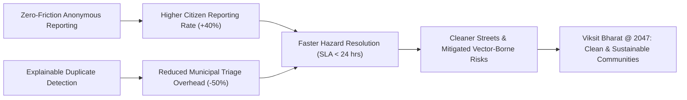

# CivicWatch — Project Analysis & Strategic Evaluation
**Event:** MyBharat Hack for Social Cause (VBYLD / MoYAS / IIT Bombay)  
**Theme:** Clean & Sustainable Communities  
**Team:** HackSphere (Tamil Nadu)  
**Target Pilot:** Greater Chennai Corporation (GCC) — Ward 172 (Adyar / Besant Nagar)  

---

## 1. Executive Summary

CivicWatch is a citizen-powered reporting and public sanitation tracking system designed to bridge the accountability gap between civic residents and urban local bodies (ULBs). By providing zero-friction anonymous reporting with photographic evidence, browser-based geolocation, transparent complaint ID generation (`CW-YYYY-TN-XXXX`), and an explainable duplicate detection engine, CivicWatch eliminates the reporting barriers found in conventional municipal apps while shielding sanitation supervisors from duplicate report fatigue.

---

## 2. Slide-by-Slide PPT Deep Analysis

### Slide 1: Cover Page
* **What the slide communicates:** Title *"CivicWatch — Citizen-Powered Cleaner Cities"*, Theme *"Clean & Sustainable Communities"*, Team *"Hacksphere"*, State *"Tamil Nadu"*. Tagline: *"Spot the problem. Start the change. A simple reporting and tracking platform for garbage and environmental issues."*
* **What is convincing:** Strong topical alignment with national urban cleanliness initiatives (Swachh Bharat Mission-Urban 2.0 / Viksit Bharat @ 2047). Concise, action-oriented tagline.
* **What is weak or unclear:** Team ID and specific pilot municipal boundary are omitted. State-level scope is too broad for an operational civic prototype.
* **What judges might question:** *"Which municipal jurisdiction or urban local body is this designed for? How will you pilot this in Tamil Nadu?"*
* **Required improvement:** Anchor synthetic demonstration data to Greater Chennai Corporation (GCC) Ward 172 (Adyar/Besant Nagar), and provide structured team ID placeholders (`HSC-TN-2025-XXXX`).

---

### Slide 2: Problem – Proposed Solution
* **What the slide communicates:**
  * *Problem:* Garbage and plastic accumulation in public spaces; confusing reporting channels; lack of feedback on whether municipal action was taken.
  * *Solution:* Single digital reporting form with photo evidence, GPS or manual location, complaint tracking ID, and visible status progression (Reported → In Progress → Resolved).
  * *Innovation:* Anonymous reporting option, evidence capture, location tagging, and status transparency in one unified flow.
* **What is convincing:** Correctly diagnoses the two core citizen pain points: high friction during reporting (demanding phone/login/Aadhaar) and "black hole" reporting (no follow-up or visibility).
* **What is weak or unclear:** "Reporting channels can be confusing" does not analyze *why* existing tools like Swachhata or CPGRAMS fail at the hyper-local level. Furthermore, anonymous reporting invites spam/duplicates if unconstrained.
* **What judges might question:** *"If anyone can report anonymously without verification, what prevents malicious users from spamming municipal workers with fake or repeated complaints for the same garbage pile?"*
* **Required improvement:** Introduce an explainable, client-side duplicate detection alert that warns users if a similar complaint exists within 200 meters filed within the last 24 hours, plus image compression and validation guards.

---

### Slide 3: Technical Approach & Working Prototype
* **What the slide communicates:**
  * Low-cost, browser-only demonstration without paid APIs or package installations.
  * Stack: HTML, CSS, JavaScript; Browser Geolocation API; FileReader photo preview; browser `localStorage` persistence.
  * Workflow: Citizen Form → Input Validation → Save + Create CW-ID → Dashboard updates status.
  * Features: Category/description reporting, anonymous default, mock authority dashboard, local session persistence.
* **What is convincing:** Outstanding strategy for hackathon survival. Zero external server dependencies or fragile third-party API keys means the live pitch cannot fail due to network drops, API rate limits, or backend timeouts.
* **What is weak or unclear:** Browser `localStorage` has a strict 5MB limit. Storing raw base64 photos will quickly trigger `QuotaExceededError`. Furthermore, it lacks automated tests and multi-role clarity.
* **What judges might question:** *"If it only uses localStorage, isn't this just a static frontend toy? What happens when two users open the site, or when 5 high-resolution photos are uploaded?"*
* **Required improvement:**
  1. Add client-side canvas-based image downscaling/compression before writing to `localStorage` (keeps image payloads < 60KB).
  2. Implement a clear Dual-View Switcher: **Citizen Mode** vs. **Municipal Ward Officer Dashboard** to prove end-to-end workflow realism.
  3. Include unit/integration tests to prove code robustness.

---

### Slide 4: Impact Potential
* **What the slide communicates:**
  * *Stakeholders:* Citizens, local communities, municipal teams, sanitation workers, people affected by environmental hazards.
  * *Benefits:* Easier waste reporting, clearer follow-up, visibility into recurring hotspots, civic participation.
* **What is convincing:** Explicitly mentions sanitation workers and municipal teams, recognizing that civic tech only succeeds when municipal workflows are respected.
* **What is weak or unclear:** Lacks quantifiable success metrics, response-time Service Level Agreements (SLAs), or a structured Theory of Change.
* **What judges might question:** *"Citizens reporting trash does not magically clean trash. How does this help a resource-constrained municipal ward prioritize waste clearance?"*
* **Required improvement:** Add category severity weighting (e.g., Toxic/Chemical waste and Blocked Storm Drains receive urgent SLA flags vs. Routine Littering) and hotspot clustering metrics.

---

### Slide 5: Feasibility & Risk Analysis
* **What the slide communicates:**
  * *Feasibility:* Low-cost, lightweight web stack; zero paid APIs; expandable to backend API & relational DB.
  * *Risks & Mitigations:* False/duplicate reports → add validation and duplicate checks; Privacy/location → collect minimal data with explicit consent; Lack of authority integration → roadmap for municipal API integration.
* **What is convincing:** Honest acknowledgment that authority integration is currently a simulation rather than a claimed government partnership.
* **What is weak or unclear:** Mitigations are listed as future ideas rather than working features in the prototype.
* **What judges might question:** *"You noted duplicate reports as your primary risk—did you actually implement duplicate mitigation in the code, or is it just theory?"*
* **Required improvement:** Build and demonstrate the actual explainable duplicate detection heuristic in the live prototype.

---

### Slide 6: Team Composition & Next Development Phase
* **What the slide communicates:**
  * Team HackSphere (Tamil Nadu). Roles: UI/Frontend, Testing & Documentation, Future Backend.
  * Next Phase: Backend API & database, verified authority login, notification history, local community pilot.
* **What is convincing:** Realistic and disciplined division of engineering responsibilities.
* **What is weak or unclear:** Member names are placeholders (`[Team member]`). No tangible pilot partner identified.
* **What judges might question:** *"Who specifically built what? What is your timeline for piloting in your local ward?"*
* **Required improvement:** Structure role attributions and provide a structured 4-week pilot rollout plan for a specific ward in Tamil Nadu.

---

### Slide 7: References
* **What the slide communicates:** MDN Geolocation API, MDN Web Storage API, GitHub repo placeholder, Demo video placeholder, AI tools disclosure placeholder.
* **What is convincing:** Adherence to academic integrity and AI transparency guidelines.
* **What is weak or unclear:** Lacks references to national civic standards, Swachh Bharat Mission benchmarks, and accessibility guidelines.
* **What judges might question:** *"Did you consult municipal sanitation standards (e.g., SBM-U 2.0 / MoHUA)?"*
* **Required improvement:** Reference MoHUA guidelines, OpenStreetMap / W3C Geolocation standards, and WCAG 2.1 AA accessibility guidelines.

---

## 3. Project Analysis Report

### 3.1 Problem Definition
In rapidly urbanizing Indian cities, open accumulation of garbage, construction debris, plastic waste, and clogged stormwater drains creates public health risks, vector-borne diseases (dengue, malaria), and urban flooding. While national portals (such as Swachhata-MoHUA) exist, citizens face friction:
1. **Mandatory Login/KYC Friction:** Citizens are forced through SMS/OTP or social logins before reporting, discouraging spontaneous reporting of transient waste.
2. **Accountability Deficit:** Lack of transparent, real-time status progression leaves citizens feeling their reports entered an administrative black hole.
3. **Supervisor Overwhelm:** Sanitation supervisors receive dozens of duplicate reports for the same open dump, wasting triage time.

### 3.2 Target User Personas
* **Persona 1 — Citizen Ananya (23, College Student / Commuter, Adyar, Chennai):**
  * *Context:* Walks past an overflowing dumpster on 2nd Avenue, Adyar daily.
  * *Pain:* Doesn't want to create an account on a cumbersome government app just to report a garbage pile. Wants to snap a photo, share the location, get a tracking token, and go.
  * *Goal:* Fast reporting (< 45 seconds) with proof and tracking without spamming personal data.
* **Persona 2 — Ward Sanitation Supervisor Murugan (46, GCC Ward 172):**
  * *Context:* Manages 4 conservancy teams and 2 mini-tipper trucks.
  * *Pain:* Flooded with redundant citizen calls; cannot distinguish between emergency hazardous waste and regular bin overflows.
  * *Goal:* Unified ward view showing unique issue locations, photo verification, priority tags, and single-click status updates with resolution notes.

### 3.3 Jobs to Be Done (JTBD)
* *When* I observe an unhygienic waste accumulation in my neighborhood, *I want to* submit photographic evidence and coordinates in under a minute without sharing private personal data, *so that* municipal workers are notified and I can independently verify when it gets cleared.
* *When* I plan daily conservancy routes, *I want to* see unique, deduplicated civic complaints categorized by urgency and street location, *so that* my team can resolve critical hazards first and maintain public trust.

### 3.4 Existing Alternatives & Competitor Analysis

| Dimension | Swachhata-MoHUA App | Municipal Helplines (WhatsApp) | CivicWatch (Proposed Prototype) |
|---|---|---|---|
| **Onboarding** | Mandatory Mobile/OTP | Chatbot prompts / text-heavy | **Instant Zero-Login / Anonymous by Default** |
| **Evidence** | Photo capture required | Photo upload allowed | **Photo capture + client-side compression** |
| **Location Tagging** | GPS only (fails indoors/poor signal) | Manual description / GPS share | **Browser GPS + Manual Street/Landmark Fallback** |
| **Duplicate Prevention** | Minimal (officer manual merge) | None (creates separate chats) | **Explainable Proximity/Time Duplicate Alert** |
| **Operational Overhead** | Heavy native app (~45MB) | External dependency (WhatsApp) | **Zero-install, ultra-lightweight Web App (<200KB)** |
| **Dual Transparency** | Citizen sees ticket; officer uses backend | Closed chat ticket | **Dual-View Switcher: Citizen Tracker & Ward Dashboard** |

### 3.5 Core Differentiators
1. **Zero-Barrier Anonymous Reporting:** Privacy-preserving by default; optional contact field only if the citizen desires SMS follow-up.
2. **Proximity-Based Duplicate Detection Engine:** Transparent, explainable rule engine that compares incoming category and location against active complaints within 200m/24h, preventing municipal fatigue without silencing citizens.
3. **Dual-View Operational Architecture:** Immediate toggle between Citizen Reporter View and Municipal Ward Supervisor Dashboard, allowing judges to test the complete lifecycle in 2 minutes.
4. **Client-Side Resilience:** LocalStorage engine with automatic canvas image downsampling (guaranteeing reliable offline/local operation without 5MB quota errors).

### 3.6 Theory of Change & Social Impact Hypothesis

### 3.7 Major Risks & Mitigations

| Risk | Likelihood | Impact | Built-in Mitigation in CivicWatch |
|---|---|---|---|
| **Spam / Fake Reports** | Medium | High | Mandatory photo evidence validation, character length thresholds, and client rate-limiting. |
| **Storage Exhaustion** | High | Medium | Client-side image compression downscaling photos to max 600px width before storage. |
| **GPS Inaccuracy / Permission Denied** | High | High | Graceful fallback to manual street selection and landmark input without blocking submission. |
| **Lack of Backend Sync in Demo** | Medium | Low | Unified `localStorage` event-driven architecture synchronizing Citizen and Officer views across browser tabs. |

---

## 4. Official Event Research & Judging Readiness Matrix

### 4.1 Event Context: Viksit Bharat Young Leaders Dialogue (VBYLD)
* **Organizer:** Ministry of Youth Affairs & Sports (MoYAS), Government of India, supported by IIT Bombay.
* **Platform:** MY Bharat Portal (`mybharat.gov.in`).
* **Eligibility:** Indian youth aged 18–29 years.
* **Theme:** Clean & Sustainable Communities (aligned with National Youth Festival 2025/2026 and SBM-U 2.0).

### 4.2 Judging-Readiness Matrix

| Judging Dimension | Target Expectation | Current PPT Baseline | Proposed Prototype Enhancement | Evidence of Completion |
|---|---|---|---|---|
| **Problem Relevance (25%)** | Solves pressing local civic sanitation problem | General garbage problem statement | Grounded in GCC Ward 172 (Tamil Nadu) urban waste realities | Realistic synthetic datasets with ward landmarks & categories |
| **Innovation & Differentiation (20%)** | Novel approach beyond generic reporting | Anonymous option noted | Proximity duplicate warning engine + client-side compression | Working duplicate modal alert in live UI |
| **Technical Execution (25%)** | Robust, error-free working prototype | Basic HTML/JS mentioned | Responsive single-page app, modular JS, automated test suite | 100% green automated test run + zero console errors |
| **Usability & UX (15%)** | Accessible, intuitive, dignified | Basic form mockup | Classic-elegant aesthetic, WCAG 2.1 AA contrast, mobile responsive | Verified across desktop & mobile viewports |
| **Scalability & Sustainability (15%)** | Realistic path to municipal adoption | Next phase bullet points | Detailed technical design doc + REST API architecture roadmap | `docs/TECHNICAL_DESIGN.md` with complete database schemas |
