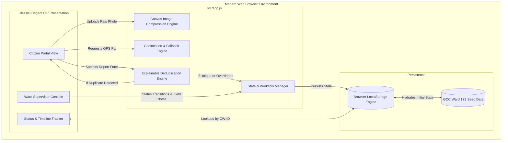
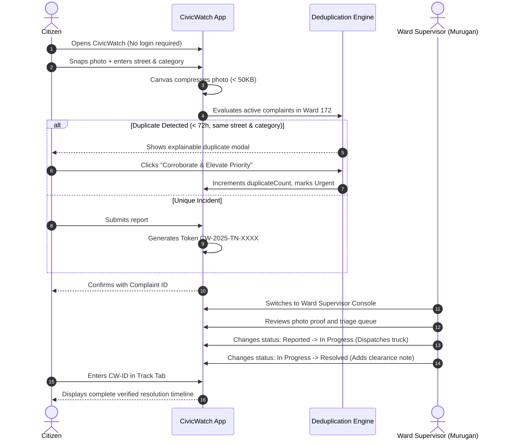
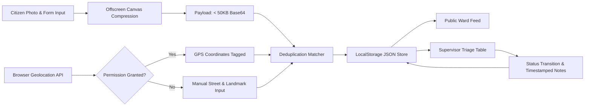
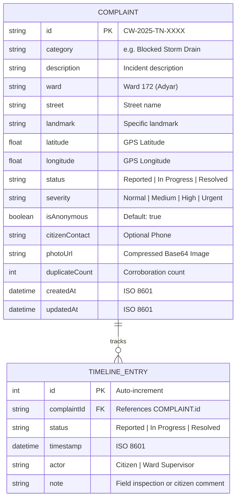
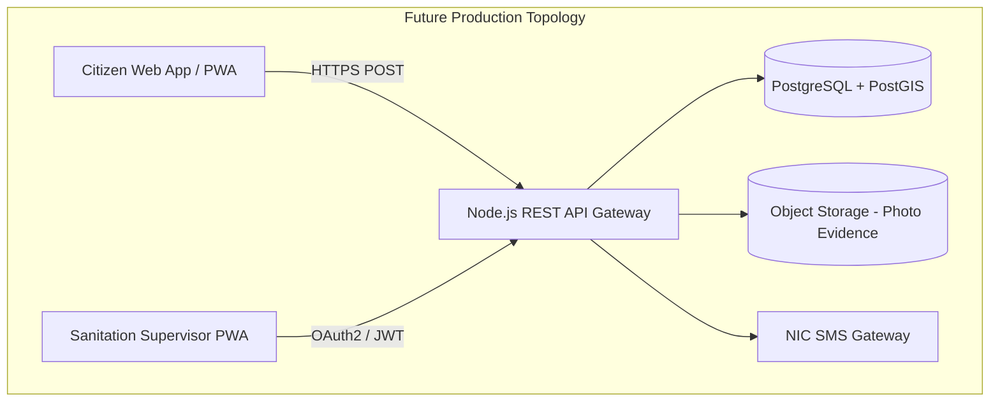

# CivicWatch — Technical Design Document
**Project:** CivicWatch — Citizen-Powered Cleaner Cities  
**Event:** MyBharat Hack for Social Cause (MoYAS / IIT Bombay)  
**Theme:** Clean & Sustainable Communities  
**Team Name:** HackSphere (Tamil Nadu)  
**Team ID:** HSC|TN|03258  
**Team Composition:**  
- **Kamalanathan K** — Team Lead & UI/Frontend Engineer  
- **Gunasri R** — QA, Documentation & Testing Lead  
- **Krishnaprasad S** — Systems & Future Backend Architect  

---

## 1. Project Overview & Scope
CivicWatch is a lightweight, privacy-preserving civic issue reporting and municipal action tracking system. It bridges the communication gap between citizens and urban local bodies (such as the Greater Chennai Corporation) without requiring mandatory identity verification, passwords, or cumbersome mobile applications.

### 1.1 Problem Statement
Urban public spaces frequently suffer from open solid waste accumulation, single-use plastic dumping, blocked stormwater drainage inlets, and illegal construction debris dumping. Existing government reporting mechanisms suffer from three main bottlenecks:
1. **High Citizen Onboarding Friction:** Requiring phone OTP or Aadhaar KYC before reporting discourages spontaneous reporting.
2. **Accountability Deficit:** Lack of transparent status tracking leads to citizen disillusionment.
3. **Supervisor Triage Overload:** Redundant reports for the same incident overwhelm conservancy supervisors.

### 1.2 Prototype Scope
The current prototype is targeted at **Greater Chennai Corporation (GCC) Ward 172 (Adyar / Besant Nagar)**. It provides an end-to-end demonstrable workflow operating client-side with persistent `localStorage`, complete with dual-role views (Citizen vs. Municipal Supervisor), real-time status transitions, client-side canvas photo compression, and an explainable duplicate detection engine.

---

## 2. Functional & Non-Functional Requirements

### 2.1 Functional Requirements
* **FR-01 (Anonymous Reporting):** Citizens can file reports with zero registration. Anonymous reporting is enabled by default.
* **FR-02 (Evidence Capture & Compression):** Photos uploaded via camera/file picker are dynamically downscaled via an offscreen HTML5 canvas to prevent client storage exhaustion.
* **FR-03 (Location Geotagging & Fallback):** Browser Geolocation API captures exact GPS coordinates. If permission is denied or unavailable, manual entry of ward, street, and landmark is fully supported.
* **FR-04 (Explainable Deduplication):** Active reports within 72 hours in the same vicinity and category trigger an advisory modal allowing the user to corroborate (upvote priority) or proceed independently.
* **FR-05 (Unique Tracking Token):** Every report generates a unique identifier formatted as `CW-2025-TN-XXXX`.
* **FR-06 (Dual-Role Console):** Instant toggle between Citizen Portal and Municipal Ward Supervisor Console.
* **FR-07 (Status Workflow):** Sanitation supervisors can update status from `Reported` → `In Progress` → `Resolved` with field inspection notes.

### 2.2 Non-Functional Requirements
* **NFR-01 (Zero-Install & Zero-Cost):** Runs directly in modern desktop and mobile web browsers without paid cloud API dependencies.
* **NFR-02 (Performance):** Page load in under 1 second; photo compression in under 200ms.
* **NFR-03 (Data Minimization):** Zero PII collected unless citizen explicitly opts into SMS notifications.
* **NFR-04 (Accessibility):** WCAG 2.1 AA compliant color contrast, readable classic-editorial typography, and accessible keyboard navigation.

---

## 3. System Architecture

### 3.1 High-Level Architecture Diagram

---

## 4. User Workflow & Use Case Flow

---

## 5. Data Flow Diagram

---

## 6. Database Schema & Data Dictionary

### 6.1 Entity-Relationship Diagram (ERD)

### 6.2 Data Dictionary

| Field | Type | Required | Constraints / Values | Description |
|---|---|---|---|---|
| `id` | String | Yes | `^CW-2025-TN-\d{4}$` | Unique public tracking token. |
| `category` | String | Yes | Enumeration (6 categories) | Standardized civic sanitation category. |
| `description` | String | Yes | Minimum 15 characters | Citizen description of the hazard. |
| `ward` | String | Yes | GCC Ward Identifier | Pilot boundary: Greater Chennai Corp Ward 172. |
| `street` | String | Yes | Non-empty string | Road or street name where hazard exists. |
| `landmark` | String | No | Free text | Notable nearby point of reference. |
| `latitude` | Float | No | Range: [-90, 90] | Geolocation coordinate. |
| `longitude` | Float | No | Range: [-180, 180] | Geolocation coordinate. |
| `status` | String | Yes | `Reported`, `In Progress`, `Resolved` | Lifecycle status in municipal workflow. |
| `severity` | String | Yes | `Normal`, `Medium`, `High`, `Urgent` | Priority weighting for conservancy triage. |
| `isAnonymous` | Boolean| Yes | `true` or `false` | Privacy flag. Defaults to `true`. |
| `citizenContact`| String | No | Regex: `^[0-9+\-\s]{8,15}$` | Optional phone for SMS tracking. |
| `photoUrl` | String | Yes | Base64 JPEG or SVG path | Photographic evidence compressed to < 50KB. |
| `duplicateCount`| Integer| Yes | `0` or positive integer | Number of citizen corroborations. |
| `timeline` | Array | Yes | Array of Timeline Objects | Immutable audit log of status actions. |

---

## 7. Future Backend Architecture Roadmap
When transitioning from the hackathon demonstration to a live multi-ward municipal pilot:
- **Backend API:** Node.js / Express or Python FastAPI service with PostgreSQL / PostGIS spatial database for geospatial radius queries (`ST_DWithin`).
- **Authentication:** Role-Based Access Control (RBAC) via DigiLocker / MeriPehchaan for municipal supervisors; zero-login token model preserved for citizens.
- **SMS Gateway:** Integration with NIC National Mobile Governance SMS Gateway for automated status dispatch.
- **Computer Vision Pipeline:** Integration of an edge classification model (MobileNet) to automatically categorize waste types (plastic vs. organic vs. C&D debris) from photos.

